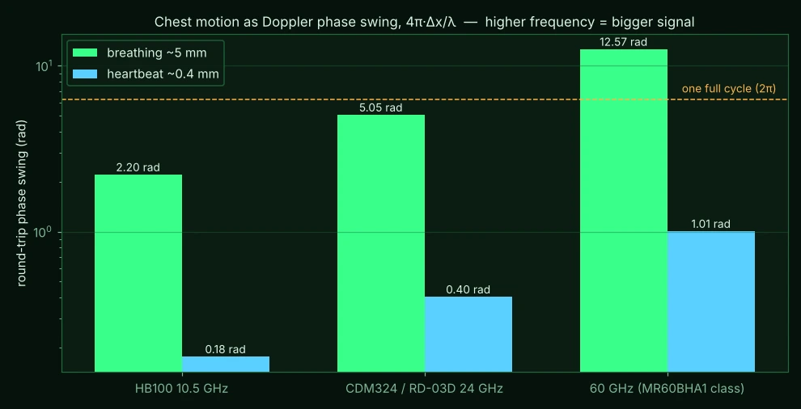
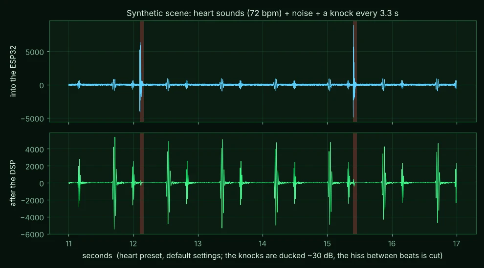

# Blip — design notes and research

Written 2026-11-05 while building v0.1.0-wip to v0.2.2-wip. Part lab notebook, part "why", with the sources used. Nothing here has been checked against real hardware yet unless it says so.

## 1. Goal

Rebuild the idea behind Stevee87's Arduino-ESP32-Radarproject with the least hardware that still does the job: one cheap ESP32 (an **ESP32-C3 Super Mini** or a **Waveshare ESP32-S3-Pico**), the same **Ai-Thinker RD-03D** radar, and an **old phone** on the node's own hotspot as the display. Add the generic **0.91"/0.96" SSD1306 OLEDs** as a second display. Then look seriously at the "Doppler stethoscope" wish: can this radar let you *hear hearts through walls*?

## 2. What the original does, and why it felt heavy

Stevee87's build: XIAO ESP32-S3 reads the radar and sends target data over UDP to an **Arduino GIGA R1 + GIGA Display Shield**, which draws the scope and drives a buzzer. Two LiPos, two chargers, two boost converters. The second, much more expensive MCU exists only to own a touchscreen. A phone has a better screen, touch, a speaker and a battery, and every household has an old one in a drawer. So: the ESP32 serves a web page, the phone draws.

Original repo, MIT: https://github.com/Stevee87/Arduino-ESP32-Radarproject — kept as inspiration; no code copied.

## 3. The RD-03D, what it really is

From the Ai-Thinker Rd-03D specification V1.0.0 (2023) and the protocol note:

| Item | Value |
|---|---|
| Chip | **Iclegend S5KM312CL** — "integrated microcontroller millimetre-wave sensor SoC", FMCW transceiver + MCU in one package |
| Band | 24.0–24.25 GHz (K-band ISM), max sweep bandwidth 0.25 GHz |
| Antennas | **1 TX, 2 RX** on the PCB ("1T2R") |
| Range | 8 m max, range resolution 0.75 m, accuracy 0.15 m |
| Field of view | ±60° azimuth, ±30° elevation |
| Supply | 5 V, ≥200 mA peak, ~92 mA typical, ripple < 100 mV |
| Interface | UART, 3.3 V logic, default 256000 baud |
| Pins on the connector | **4: 5V, GND, TX, RX** — that's all |
| Output | up to 3 tracked targets: x, y (mm), radial speed (cm/s), range gate (mm) |

About "multi-channel / multi-band": the module is **one band** (24 GHz) with **two receive channels**. The two RX antennas let the chip's firmware estimate bearing from the phase difference between them (that's where the x coordinate comes from). It is not a multi-band radar, and the two channels are not accessible from outside the chip.

The datasheet's "GPIO" section mentions that "some IO ports are drawn from the periphery of the module" and that they are 3.3 V. These are unlabelled test pads; nothing documents what they are. There is no public SDK for the S5KM312CL that I could find (searches for an Iclegend SDK / raw ADC / I-Q output came up empty), and the chip's firmware is Ai-Thinker's. **The range-Doppler processing, target detection and tracking all happen inside the chip; only the tracker's answers come out.**

### 3.1 Frame format and the sign-bit gotcha

Covered in HOW_IT_WORKS.md. The short version: each of x, y, v is a 15-bit magnitude with bit 15 = "positive". Ai-Thinker's worked example (`0E 03` → −782 mm, `B1 86` → +1713 mm, `10 00` → −16 cm/s) is in both test suites. Popular sketches that subtract 0x200/0x8000/0x10 only happen to agree with that one example; Blip uses the sign bit.

### 3.2 Report rate

Users report the module streams "very frequently" (ESPHome's component adds a throttle for that reason). I have not measured it; the firmware counts frames per second and shows it in the UI so the first real run will tell us. The web UI is rate-limited to 20 updates/s regardless.

## 4. Could the RD-03D be bit-banged into a Doppler stethoscope?

> **Update 2026-11-13:** an experimental custom firmware now exists for the LD2450 (same radar chip) that streams range bins over USB, so raw *digital* data is possible after all. See [docs/RADAR_TRACKING_NOTES.md](docs/RADAR_TRACKING_NOTES.md) §6. The text below is kept as written.

Short answer: **no, not through its UART**, and probably not at all without reverse-engineering an undocumented SoC. Long answer, with numbers.

### 4.1 What a heartbeat looks like to a radar

A CW or FMCW radar sees a target's motion as the phase of the reflected signal. Moving the chest wall by Δx changes the round-trip phase by

> Δφ = 4π · Δx / λ

- Breathing moves the chest ~4–12 mm; heartbeat moves the skin surface ~0.2–0.5 mm.
- At 24 GHz, λ = 12.5 mm → breathing ≈ 5 rad (nearly a full cycle), heartbeat ≈ **0.4 rad** (≈ 23°).
- At 10.5 GHz (HB100), λ = 28.5 mm → heartbeat ≈ 0.18 rad.
- At 60 GHz the heartbeat swing is ~1 rad, which is why the commercial vital-sign modules (Seeed MR60BHA1 and friends) sit at 60 GHz.

To extract a heartbeat you need the **I/Q baseband** (or at least one channel of it) sampled at tens of Hz with sub-tenth-of-a-radian stability, then a band-pass around 0.8–3 Hz and some patience: the breathing signal is ten times bigger and sits next door in frequency.

### 4.2 What the RD-03D gives you instead

- Radial **speed as an integer in cm/s** for each *tracked* target. A heartbeat's chest velocity is of order 0.4 mm × 2π × 1.2 Hz ≈ 3 mm/s = **0.3 cm/s** — below the resolution of the number, and the tracker is built to ignore exactly this kind of micro-motion as "static".
- Position in **0.75 m range gates**, filtered by a tracker that holds targets for a configurable retention time.
- A chip whose internal ADC, mixer outputs and FFT buffers are not on any pin.

So the information needed for a stethoscope is destroyed inside the chip long before the UART. "Bit-banging" would mean finding the chip's debug port (SWD-like pads on the module edge are plausible but undocumented), dumping and replacing Ai-Thinker's firmware, and writing a radar signal chain for an SoC with no public datasheet. That's a research project in its own right; it is parked, not forgotten (see §9).

### 4.3 What *does* work: a CW Doppler module with an IF pin

The classic motion-sensor modules put the mixer output on a pin:

| Module | Band | IF output | Notes |
|---|---|---|---|
| **HB100** | 10.525 GHz | yes, µV–mV | the £3 standard; through-wall capable; 70 Hz per m/s |
| **CDM324** | 24.125 GHz | yes (IF pin) | same footprint as HB100, 24 GHz so 2.3× the phase swing; 160 Hz per m/s |

Either one, plus an amplifier into the ESP32 ADC, gives a waveform that *is* the chest (or throat, or walker) motion. That is the **Stetho channel** in Blip. v0.1 sent the raw 2 kHz waveform to the phone and did everything there; v0.2 moves the clean-up onto the ESP32 and uses a modded MAX4466 microphone board as the amplifier (§11).

### 4.4 "Hearing" a heart

There are two different things to hear:

- **The beat itself** is ~1 Hz chest *motion*, far below hearing. It can only be shown (the chest-motion trace) or translated (a synthesised "thump" on each detected beat — the *Beat thumps* button).
- **Heart sounds** (S1/S2, the valves closing) are genuine vibrations of the chest wall at roughly 20–150 Hz, and a CW radar can pick them up: Will et al. (2018, Scientific Reports) detected S1 and S2 contact-free with a CW radar and matched a phonocardiograph's timing closely (§Sources). That's what the **Heart** preset tries to let you hear directly. The throat buzzes at the voice's fundamental (85–255 Hz) while someone talks (**Voice** preset), and breath noise is broadband hiss (**Lungs**). People walking make the Doppler warble (**Raw**), and that does go through plasterboard.

### 4.5 Through walls: what the literature says

- Pramanik & Islam, *Through the wall human heart beat detection using single channel CW radar*, Frontiers in Physiology 2024: a single-channel 24 GHz CW radar recovered heart rate through wood and **brick** barriers for subjects **20–100 cm** from the radar, with wavelet processing (MODWT), and even separated two people. https://www.frontiersin.org/journals/physiology/articles/10.3389/fphys.2024.1344221
- Georgia Tech's "Radar Flashlight" (1998): 24.1 GHz, breathing detected through doors and walls at up to ~10 ft; heartbeat at longer range only with a much larger antenna. https://www.designnews.com/industry/hand-held-radar-device-detects-breathing-heartbeats
- Malešević et al., *Contactless Real-Time Heartbeat Detection via 24 GHz Continuous-Wave Doppler Radar Using Artificial Neural Networks*, Sensors 2020: heartbeat-by-heartbeat detection at 24 GHz CW, line of sight. https://pmc.ncbi.nlm.nih.gov/articles/PMC7219229

Realistic expectations for a £3 module and a breadboard amplifier:

| Target | Line of sight | Through a plasterboard stud wall | Through brick |
|---|---|---|---|
| Walking person | easy, many metres | yes, reduced range | maybe, close |
| Breathing, person sitting still | yes at 1–2 m | plausible at < 1 m | doubtful |
| Heartbeat | plausible at < 1 m, subject very still, breath held helps | **hard**; the paper managed ≤ 1 m with careful processing | no |

Everything else in the room must be still: a curtain moving is a bigger signal than a heart. Expect the first real test to be "breathing through a door", which is still a great party trick.

**Not a medical device**, and treat the privacy angle with care: this is the same physics as the search-and-rescue life detectors, in a hobby box.

## 5. Decisions and the alternatives dropped

| Decision | Why | Rejected |
|---|---|---|
| Node is its own Wi-Fi **hotspot** | works in a field, in a basement, with any old phone; no router config | STA mode joining home Wi-Fi (maybe later as an option), BLE (no browser UI), ESP-NOW to a second node (that's the two-MCU design again) |
| **WebSocket** for data, **HTTP polling** as fallback | 20 Hz updates without reconnect overhead; polling keeps ancient browsers working | Server-Sent Events (no binary) |
| **ESPAsyncWebServer** (ESP32Async fork) | non-blocking, WebSocket built in, still maintained in 2025 | Arduino `WebServer` (no WebSocket; blocks), ESP-IDF httpd (not Arduino-friendly) |
| Single HTML file **gzipped into flash** | no filesystem image to upload separately; `tools/embed_web.py` rebuilds it | LittleFS data upload (one more step for the flasher) |
| **U8g2** for the OLED, runtime-selectable size | one library covers 128×32 and 128×64; the size is a setting, not a build flag | Adafruit_SSD1306 (needs the size at compile time) |
| Raw Stetho samples to the phone | DSP in JS is quicker to iterate; phone has the speaker | on-node FFT/rate estimation |
| Pins from `platformio.ini` only | diagrams and `/api/status` read the same numbers; nothing to drift | pins in `config.h` and in docs separately |
| **C3 Super Mini pins**: radar on GPIO20/21, I2C on GPIO6/7, ADC on GPIO1 | 20/21 are the board's RX/TX pads (UART0 is free because the C3 uses native USB-CDC); 6/7 are plain IO (JTAG, unused); GPIO1 is ADC1. Avoided: GPIO5 (ADC2 is unusable with Wi-Fi), GPIO2/8/9 (strapping pins, LED, BOOT) | — |
| **S3-Pico pins**: radar on GPIO12/11, I2C on GPIO17/18, ADC on GPIO7 | these are the Pico-position GP0/GP1, GP6/GP7 and A1 that Waveshare's own UART/I2C/ADC demos use, so a Pico breadboard layout carries over; GPIO7 is ADC1 | — |
| PolyForm Noncommercial licence | the project's own code; nothing GPL incorporated | — |

## 6. Measurements

None yet on hardware. From the simulator and tests:

- Parser: 3 frames recovered from a stream containing junk, a 12-byte ACK and a half frame; header-like bytes inside the payload do not break framing (`tests/test_parser.cpp`, `tests/test_parser_py.py`).
- Web UI: 25.5 kB HTML → 9.7 kB gzip in flash.
- Stetho estimator on the synthetic signal (72 bpm beats on 15/min breathing with noise): reported 73 bpm and 15/min after ~8 s (Chromium, Playwright run).
- Simulator → Chromium: WebSocket delivered 79 messages in 2 s (40 target frames + 39 binary Stetho frames) with zero console errors.

## 7. What was tried and dropped

- Hijacking the HTTP socket for WebSocket in the Python simulator initially failed silently because `socketserver` shuts the socket down after the handler returns; fixed by overriding `shutdown_request` for hand-offs (`tools/sim_radar.py`).
- Heart-rate estimate picked the autocorrelation's global maximum, which was the shortest allowed lag whenever breathing leaked in (150 bpm). Switched to a steeper 0.8 Hz high-pass (two cascaded biquads) and the *first local* peak of the autocorrelation.
- A `display:flex` modal ignored the `hidden` attribute (`[hidden]{display:none!important}` fixed it).

## 8. Untested / unknown

- **Firmware compiles but has not run.** v0.2.0-wip builds cleanly for both envs with pioarduino (Arduino-ESP32 3.3.12). C3: 13% RAM, app 1.18 MB in the 3 MB `huge_app` partition (since 2026-11-13 all builds use a 2 MB layout, `firmware/partitions_2mb.csv`, 1.875 MB app). S3: 16% RAM. Nothing has been flashed yet.
- ADC continuous (DMA) mode at 8 kHz alongside Wi-Fi on the single-core C3: should be fine (it's DMA), but unmeasured. `overruns` and `dropped` in `/api/status` will tell.
- I2S PDM-TX at 8 kHz on the C3/S3 is used for the earphone output; the clock/up-sampling defaults come from Arduino's `ESP_I2S`. Untested by ear. The ADC and the I2S run from different clock dividers, so a tiny drift may cause a click every few minutes.
- The real level out of a CDM324 + MAX4466 at 0.3–1 m, and therefore whether heart sounds are audible at all, is unknown until someone builds it.
- The DSP thresholds (bump trigger, noise floor tracking, AGC targets) are tuned on a synthetic scene only.
- Sign convention of the reported speed (approaching = negative is assumed from one write-up).
- Actual RD-03D frame rate.
- Whether the captive portal pops on iOS as well as Android.
- U8g2 HW-I2C constructor with explicit SCL/SDA pins on the C3.
- The MAX4466 mod is reasoned from the board's topology, not measured; the component values on clone boards vary.
- The S3-Pico GP2–GP5 = GPIO13–16 mapping is inferred from Waveshare's sequential numbering; check before soldering.

## 9. Ideas for later

- **I/Q Stetho:** a second ADC1 pin would do it (v0.2 dropped the reserved `PIN_STETHO_Q` to free pins for audio out). With a quadrature module (or two HB100s offset by λ/8) the phase can be unwrapped properly and the "null point" problem of single-channel CW goes away.
- Use the RD-03D's "someone is at 0.8 m, dead ahead" to **gate** the Stetho channel (only sonify when a target is close and still).
- CSV logging of the Stetho waveform in the browser for offline analysis; a spectrogram view.
- STA mode + mDNS (`blip.local`) as an option.
- Poke at the S5KM312CL's edge pads with a logic analyser during boot: if there is a UART debug console or SWD, note it here.
- Enclosure with a 3.7 V cell + boost, like the original.

## 10. How to test a change

1. `g++ -std=c++11 -I firmware/include tests/test_parser.cpp -o /tmp/t && /tmp/t` and `python3 tests/test_parser_py.py` — both print `RESULT: PASS`. `g++ -std=c++17 -I firmware/include tests/test_audio_dsp.cpp -o /tmp/d && /tmp/d` prints `ALL PASS`.
2. `python3 tools/embed_web.py` after touching `web/index.html`.
3. `python3 tools/sim_radar.py --no-browser` and open the page on a phone; check the scope, Settings round-trips, and that Stetho shows ~72 bpm / 15 per min and plays sound after *Listen on phone*.
4. `python3 tools/draw_illustrations.py` if a pin changed; look at every image in `docs/images/`.
5. On hardware: `pio run -e c3-supermini -t upload`, watch the serial monitor for `Blip 0.2.0-wip`, join the hotspot, and compare `/api/status` counters (`frames` rising, `bad` near zero).

## 11. v0.2 — the audio build (MAX4466, on-node DSP, three outputs)

Asked for: use a MAX4466 board instead of hand-biased op-amps; push live audio to the phone over the WebSocket with as little delay as possible; add delta-sigma audio for 3.5 mm earphones and a cheap amp board; do the AGC and noise suppression on the ESP32, tuned to reject bumps and lift heart, lungs and larynx; warn about DC on the old mic pads; and say whether the RD-03D and a CDM324 clash.

### 11.1 MAX4466 board as the amplifier
The board is a complete single-supply preamp: mid-rail bias, adjustable gain (×25–×125), output idling at VCC/2. Its gain leg is AC-coupled (DC gain ≈ 1), so a radar IF offset can't rail it. It is an *audio* amp, so its low-frequency corner (tens of Hz, depending on the board) is right for heart sounds and voice, and weak for the 0.2–2 Hz chest motion. Upsizing the gain-leg cap fixes that (hardware/max4466-mod.md). The important trap is the **mic bias resistor**, which would push ~1.5 mA of DC into the CDM324's IF pin, so the mod removes it (or adds a series DC-block cap). ×125 is less gain than the old two-stage plan (×3000+). Two modded boards in series cover the gap, and the on-node AGC adds up to 48 dB digitally. Its limit is the 12-bit ADC's own noise.

### 11.2 Why the DSP moved onto the ESP32
Earphones and the amp board have to work with no phone. So the node does the clean-up, and the phone, earphones and speaker all hear the same processed signal. The C3 has **no FPU**, so the per-sample path is fixed-point: Q28 biquads with 8 extra state bits **and error feedback**. Without it, the native test showed a 3 Hz high-pass at 8 kHz sitting ~350 LSB off zero from truncation bias, the 1/(1+a1+a2) gain at work. An earlier version of the bump detector only "passed" its test because of that offset; fixing the filter exposed it, and the detector was redesigned (below). The estimated cost is about 500 cycles a sample, i.e. a few % of the C3 at 8 kHz.

Chain (`firmware/include/audio_dsp.h`, tested by `tests/test_audio_dsp.cpp`):

1. **Bump gate.** A fast envelope (0.5 ms attack) of the near-raw signal is compared with a background of *typical peaks* (0.3 s up, 3 s down, frozen during a bump). Above k× the background (k = 30…3 from the *Bump rejection* slider), or with the ADC at a rail, the audio is ducked by 30 dB within 1 ms, held for 150 ms and released over 120 ms. A 4 ms look-ahead delay means the duck lands *on* the knock's leading edge, not after it. Tracking peaks rather than the mean is what keeps heart sounds (spiky, ~10% duty) from triggering it.
2. **Preset EQ.** High-pass, one peaking lift, low-pass. Heart: 15–250 Hz, +6 dB at 45 Hz. Lungs: 100–1500 Hz, +4 dB at 400 Hz. Voice/larynx: 70–3000 Hz, +4 dB at 200 Hz. Wide: 15–3400 Hz. Raw: 3–3600 Hz, nothing else.
3. **Noise suppressor**, the same idea as SquawkBox's goal of "remove the background, keep the voice". (Only my notes on SquawkBox were reachable from here, not its code, so this is a fresh implementation of the usual approach.) Four band-passes split the signal. Each band tracks its own noise floor (falls fast to quiet stretches, rises over ~6 s) and gets a Wiener-style gain g = 1 − α·noise/envelope, clamped to a floor (−6…−24 dB from the slider). The output is `g_res·(x − Σbands) + Σ g_i·band_i`, so with every gain at 1 it is *exactly* the input: no colouring when there's nothing to remove.
4. **AGC.** It follows a peak-ish level (5 ms up, 1 s down) towards about −9 dBFS. It is frozen during bumps, so a knock doesn't pump the gain down. It is capped so the noise floor never rises above about −24 dBFS, so silence stays quiet rather than turning into hiss. The ceiling is user-set (0–48 dB), and there is a manual mode.
5. **Limiter.** Soft knee at 24000, hard clip flagged to the phone.

The native test result on the synthetic scene (heart sounds + noise + knocks 25 dB louder): knocks end up **~38 dB** down relative to heart sounds, the hiss between beats **~11 dB** down, no false bump triggers over 45 heart-sound bursts, and no clipping. The Raw preset passes a tone at 0.00 dB gain with 66 dB SNR. `examples/dsp_before.wav` and `dsp_after.wav` are that scene, so you can listen; `docs/images/dsp-demo.webp` shows it.

### 11.3 "Unbuffered, no latency" to the phone — what's actually possible
Truly unbuffered audio over Wi-Fi isn't possible: packets arrive in bursts and a player with no buffer clicks constantly. Instead, every stage is kept as short as it can be:
- The ADC runs in DMA mode, and the node processes in 8 ms blocks.
- The node sends 256-sample (32 ms) packets of mu-law bytes with `TCP_NODELAY` and Wi-Fi power-save off, from `loop()`. A test build sent them from a separate FreeRTOS task instead, and the C3 froze within seconds of Stetho starting (no reset, web server dead). It is most likely a lock-up inside AsyncTCP/ESPAsyncWebServer when two tasks send at once, but that isn't confirmed, so all WebSocket output stays in `loop()`. That is about 33 audio messages a second at ~8 KB/s. The first version sent 128 int16 samples (16 ms) from `loop()`. On a C3 talking to a laptop, about 90 small messages a second (audio + vitals + targets + status) overran what the link could acknowledge: packets were dropped, audio lagged by seconds and the status stopped updating. Each phone's queue is now capped at 8 messages, and full queues discard, so playback never drifts behind real time. The phone's *Delay* readout counts the losses.
- The phone plays through a ring buffer that aims at **40 ms**, nudges its playback rate ±2% to follow the node's clock, and jumps forward if it falls 120 ms behind. It runs in an AudioWorklet where the browser allows it (https/localhost) and otherwise in a ScriptProcessor (512 frames). The node's page is plain http, so on a real phone it will be the ScriptProcessor.
- In the simulator, Chromium reported 54–83 ms end to end (buffer + output latency + one packet). Expect roughly 60–120 ms on an old phone. The earphone and speaker outputs on the node skip Wi-Fi entirely: about 8 ms block + I2S DMA, i.e. ~20 ms.

### 11.4 Delta-sigma earphones, I2S amp
The "pseudo-PWM" output uses the I2S peripheral in **PDM-TX mode**, which is a hardware delta-sigma modulator clocked by DMA (≈2 MHz bit stream at 8 kHz audio). The SDM peripheral (`sigmaDeltaWrite`) would also work, but it has to be fed a new value every 125 µs by software, which means timer jitter on a single-core chip that's also running Wi-Fi. PDM needs only one data pin, plus a 470 Ω / 100 nF RC and a 220 µF coupling cap. The amp option is a MAX98357A (I2S, despite "I2C" often being written). Both share the one I2S peripheral on the C3, so it's one output at a time.

### 11.5 Running the RD-03D and a CDM324 together
**Yes, they can clash.** The RD-03D is FMCW in 24.00–24.25 GHz (§3). The CDM324 is a fixed CW tone at ~24.125 GHz, inside that sweep. Each time the RD-03D's chirp sweeps past 24.125 GHz, the CDM324's mixer sees a beat note racing through 0 Hz, which is a click. At the chirp/frame rate those clicks become a buzz in exactly the band you are listening to. Going the other way, the CDM324's steady tone shows up in the RD-03D's dechirped signal as an interference burst, which can raise its noise floor or add ghosts. How bad depends on how much one antenna sees of the other (side by side, facing the same way: some; facing each other: a lot). It is untested.

Options, best first:
1. **Use an HB100 (10.525 GHz) for the Stetho.** It is a different band, so there is no clash. The cost is ~2.3× less phase swing (weaker heart signal).
2. **Switch the radar off while listening.** v0.2 supports an optional high-side switch on the RD-03D's 5 V (`PIN_RADAR_PWR`, Settings → *Radar off*). Tracking stops while Stetho is on.
3. Physical: mount them back to back, or with metal or absorber between them. The bump gate will catch some clicks but not a steady buzz.

## 12. v0.2.1 — a better target filter, the mode-command fix, power and the OLED

### 12.1 What the original project actually does with the targets
I read Stevee87's firmware (v1.1). The "tracking algorithm" in its README is the RD-03D's own, inside the chip. On top of it, his sketches add three simple things:
1. **Range gate:** keep only targets between 10 cm and 8 m.
2. **Clustering** (sender): two targets closer than 1 m are merged into one (averaged position, faster speed kept), aimed at "torso + waving arm = two people".
3. **Still-ghost filter** (receiver): a slot whose position hasn't changed by more than a few cm for 2 s is hidden, on the reasoning that the RD-03D doesn't hold still people anyway, so a dot that doesn't move is suspicious.

His frame decoding uses the same sign-bit rule as Blip (`raw ≥ 0x8000 → raw − 0x8000`, else `−raw`), which confirms §3.1.

**It also showed a bug in Blip:** his mode change is *enable configuration → multi-target → end configuration*, 200 ms apart. Blip ≤ v0.2.0 sent only the middle command, which the module very likely ignored, so the single/multi setting probably did nothing. Fixed in v0.2.1 with a non-blocking 3-step sequence run from `loop()`.

### 12.2 Why not just copy those filters
- **Merging within 1 m** also merges two real people walking close together, and it works on the chip's slot numbers, which can swap between frames.
- **Hiding still slots** works per slot, so a slot swap moves the "still" timer to the wrong person. It also hides a person the moment they stop, which is usually when you want to see where they are.
- **Neither tackles the two big sources of false positives:** one-frame flickers and multipath reflections. A reflection is the radar seeing you via a wall or window, and it appears as a second "person" further out, moving in step with you.

### 12.3 What bigger mmWave people trackers do
TI's people-counting demo ("group tracker") and MathWorks' mmWave people-tracking example share a common structure: **gating → association → per-track filter (Kalman / alpha-beta) → track management** (tentative tracks confirmed after M-of-N detections, deleted after misses), plus clutter handling (static/"boundary" regions, minimum points and SNR to allocate a track). The RD-03D gives no SNR or point clouds, only up to 3 already-clustered points, so Blip uses the same structure scaled down: brute-force association (≤ 3 × 6 pairings), alpha-beta filters, 3-of-5 confirmation and 1 s coasting. On top of that are two cheap heuristics for what the chip gets wrong most: the same-bearing/lockstep **ghost test** and a learned **clutter map**. The ghost test compares the module's own (smoothed) Doppler speeds rather than speeds worked out from positions, because the latter came out far too noisy in the first test run (the ghost was never caught). Details in HOW_IT_WORKS.md.

### 12.4 How it was tested (synthetic, `tests/test_tracker.cpp`)
At 20 Hz with ~120 mm position noise and the chip's slots shuffled every frame:

| Scene | Result |
|---|---|
| one walker, 60 s, 0.3 s dropouts | kept **one id** throughout; position error 93 mm rms vs 126 mm raw |
| 15% one-frame flickers | **0** shown in 1159 frames |
| wall reflection 1.2 m behind (seen 80% of frames) | hidden **100%** of the time; the real person shown 100% |
| fan wobbling in place | muted after 30 s (0 frames shown after 35 s); a person walking past it still shown 100% |
| two people crossing 0.6 m apart | both kept their own ids |
| real person behind, moving differently | never mistaken for a ghost |
| detections at 79°, 5 cm, 9 m | never shown |
| **known limitation:** two people in single file, in step | the second is hidden (it looks exactly like a reflection) |

In the simulator's messy room (two walkers, a wall reflection, a fan and flickers; 4 random seeds × 150 s), once the fan had been learned it was shown in 0–6% of frames when nobody was near it, and a walker was shown in 92–99% of frames. The misses are mostly the chip's 3-slot limit, with the reflection and the fan taking slots. Two fixes came out of that run: stillness is now judged on a ~1 s average position, because noise and coasting kept resetting the timer, and a learned spot covers a 1.5 m patch, because the fan sat on a cell edge.

`tests/test_tracker_py.py` replays 3 minutes of messy detections through the C++ and the simulator's Python copy: the same ids in 99.94% of frames, positions within 1 mm.

That's why it is an **opt-in experimental mode** (Settings → Target filter → Smart), with *Show filtered* on the Scope so you can see what it hides. Real rooms will need tuning; the thresholds are in `blip_track::Cfg`.

### 12.5 Power: no "sleep" on either radar
I found no documented sleep or transmitter-off command for the RD-03D. Its config mode stops the UART reports, but nothing says the 24 GHz sweep stops. The CDM324/HB100 are an oscillator and a mixer with no enable pin. So power is cut with optional high-side switches (`PIN_RADAR_PWR`, `PIN_STETHO_PWR`). Don't switch ground: the RD-03D's UART lines would back-feed it, and a floating CDM324 ground puts a big step through the MAX4466's coupling cap. *Auto-sleep* powers each radar down after N minutes with nobody watching or listening.

### 12.6 OLED
v0.2.0 drew a dot plus a slot number and spent a whole text row on "3 tgt 1.88m −16cm/s". From v0.2.1:
- **Each person is a circle with their distance inside:** whole metres in a 5×7 (or 4×6) digit and tenths as a smaller raised 3×5 digit, so 1.9 m reads "1⁹" with no decimal point. The nearest person is drawn solid (inverted).
- **No status row at all.** The 120° sector is stretched to fill the panel. The Smart-filter diamond sits in the top-left corner and the Wi-Fi icon with the phone count in the top-right, both outside the sector. The IP address appears bottom-left only while no phone is connected. "NO RADAR" and "SLEEP" appear in the middle only when that's the case.
- The drawing code (`oled_draw.h`) writes into a plain buffer in the SSD1306 page layout. The firmware copies it into U8g2's frame buffer, and `tests/oled_render.cpp` runs the identical code on a PC to make the README previews. They are exact renders, not mock-ups.

## Sources

- Stevee87, *Arduino-ESP32-Radarproject* firmware v1.1 (`rd03d_xiao_s3_sender.ino`, `rd03d_giga_receiver.ino`) — range gate, 1 m clustering, 2 s still-ghost filter, enable/mode/end command sequence: https://github.com/Stevee87/Arduino-ESP32-Radarproject
- MathWorks, *People tracking using mmWave radar* (gating, association, track confirmation): https://www.mathworks.com/help/radar/ug/people-tracking-mmwaveradar-example.html
- TI, *3D people counting tracker layer tuning guide* and *pplcount customization guide* (allocation, gating, state transitions, static/boundary handling): https://dev.ti.com/tirex/content/mmwave_industrial_toolbox_4_11_0/labs/People_Counting/docs/3D_people_counting_tracker_layer_tuning_guide.pdf and https://e2e.ti.com/cfs-file/__key/communityserver-discussions-components-files/1023/pplcount_5F00_customization_5F00_guide.pdf
- Ai-Thinker, *Rd-03D Specification V1.0.0* (2023): https://en.ai-thinker.com/Uploads/file/20231016/20231016032622_13559.pdf
- Ai-Thinker Rd-03D product page / Digi-Key listing (S5KM312CL, 256 kbps): https://www.digikey.com/en/products/detail/ai-thinker/RD-03D/24614840
- Electronic Clinic, *Rd-03D mmWave Radar: Multi-Human Tracking…* (2024) — frame examples and commands: https://www.electroniclinic.com/rd-03d-mmwave-radar-multi-human-tracking-with-distance-speed-positioning/
- ESPHome RD-03D component (256000 baud, Doppler-only caveat, throttle): https://esphome.io/components/sensor/rd03d/
- Stevee87, *Arduino-ESP32-Radarproject*: https://github.com/Stevee87/Arduino-ESP32-Radarproject
- Waveshare ESP32-S3-Pico wiki (pin map, demos): https://www.waveshare.com/wiki/ESP32-S3-Pico
- ESP32-C3 Super Mini pin references: https://lastminuteengineers.com/esp32-c3-super-mini-pinout-reference/ and https://www.sudo.is/docs/esphome/boards/esp32c3supermini/
- Pramanik & Islam (2024), Frontiers in Physiology: https://www.frontiersin.org/journals/physiology/articles/10.3389/fphys.2024.1344221
- Malešević et al. (2020), Sensors, PMC7219229: https://pmc.ncbi.nlm.nih.gov/articles/PMC7219229
- Design News (1998), GTRI Radar Flashlight: https://www.designnews.com/industry/hand-held-radar-device-detects-breathing-heartbeats
- Will, Shi, Schellenberger, Steigleder, Michler, Fuchs, Weigel, Ostgathe, Kölpin, *Radar-Based Heart Sound Detection*, Scientific Reports 8:11551 (2018), doi:10.1038/s41598-018-29984-5 — CW radar, S1/S2 detected, F1 ≈ 92% vs ECG: https://cris.fau.de/publications/202373734/
- Analog Devices EngineerZone, MAX4466 application-circuit thread (bias, coupling and corner-frequency discussion): https://ez.analog.com/audio/f/q-a/599838/clarification-regarding-the-max4466-application-circuit
- Core Electronics forum, Adafruit MAX4466 (ADA1063) schematic discussion (AC-coupled gain leg, unity gain at low frequency): https://forum.core-electronics.com.au/t/electret-microphone-amplifier-max4466-ada1063/3122
- Adafruit MAX4466 product page (gain 25×–125×, 2.4–5.5 V): https://www.adafruit.com/product/1063
- limpkin's HB100/CDM324 Doppler backpack (speed-measuring amp, frequency output; retired): https://www.tindie.com/products/limpkin/hb100-doppler-speed-sensor-arduino-compatible/
- ESP-IDF 5.5 headers shipped with Arduino-ESP32 3.3.12: `esp_adc/adc_continuous.h` (`adc_continuous_read_parse`), `ESP_I2S.h` (`I2S_MODE_PDM_TX`), `soc_caps.h` (`SOC_I2S_SUPPORTS_PDM_TX = 1` on C3 and S3).
- HB100 amplifier notes: https://www.instructables.com/Easy-HB100-Amplifier and https://tmrh20.blogspot.com/2016/06/hb-100-gh1420-10.html
