# Blip

**WORK IN PROGRESS: MANY FEATURES MAY BE BROKEN** — proof of concept, v0.2.2-wip

### Turn a tiny radar chip and an old phone into a people-spotting radar 📡

Ever wanted to know who is walking about, and how far away they are, without a camera? Blip does it with a tiny radar chip and a spare phone. The chip sends out invisible radio waves and listens for the echoes. When someone moves, the echo changes, and Blip works out where they are.

The phone is the screen. Blip makes its own Wi-Fi network; you join it, open a web page, and a glowing green radar scope appears, like something from a submarine film. Up to three people show up as dots with their distance, direction and speed. No app to install, no internet needed, no cloud, no camera.

**How it works, in three steps**
1. Plug a little ESP32 board into a radar chip (the Ai-Thinker **RD-03D**) and power it from USB.
2. Join the Wi-Fi network called *Blip-Radar* on any old phone, tablet or laptop.
3. Open the page and watch the dots move. Walk about and see yourself on the scope!

**Good things to know**
- It only sees things that **move**. Someone sitting very still fades from the scope.
- It also bounces off big metal things such as fridges, so a small room can look busy.
- A tiny optional screen (an OLED) can sit on the board and show the same picture. Blip finds it by itself when it starts.
- You can switch between tracking the one nearest person or up to three.

It is a slimmed-down take on [Stevee87's Arduino-ESP32-Radarproject](https://github.com/Stevee87/Arduino-ESP32-Radarproject), which pairs the same radar with a XIAO ESP32-S3 *and* an Arduino GIGA R1 + display shield. The drawing is the easy part; a phone already does it.

> Required Notice: Copyright Matthew Armstrong (https://github.com/The-Dorkknight).
> Licensed under the [PolyForm Noncommercial License 1.0.0](LICENSE.md) — source-available, free for non-commercial use. Provided as-is with **no warranty and no liability**. **Not a medical device.** Radar can see motion through thin walls: respect other people's privacy and the 24 GHz rules where you live.

Project started 2026-11-05 10:24.

📘 **The whole manual and research notes as one PDF:** [docs/Blip-manual.pdf](docs/Blip-manual.pdf) (also attached to every release).

<p align="center">
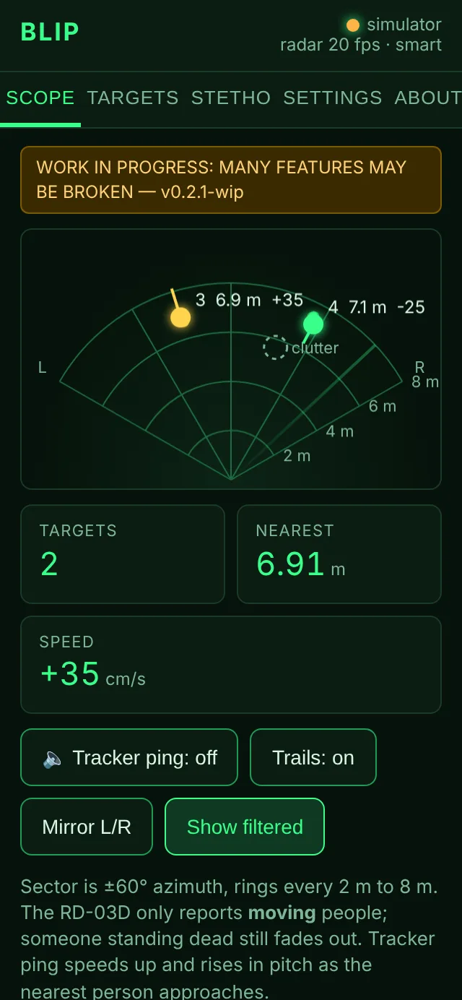
</p>
<p align="center"><i>Phone screenshot from the simulator (tools/sim_radar.py).</i></p>

## Bonus experiment: the Stetho add-on (parked)

The idea: use a second, very cheap radar-style module (a £3 CDM324 or HB100 Doppler sensor) as a **stethoscope that listens to a heartbeat from a distance**. A modded MAX4466 microphone board boosts the signal, and the ESP32 cleans up the sound (ducks knocks, lifts heart, lung and throat sounds, cuts hiss) and plays it live to the phone, to 3.5 mm earphones, or to a small speaker.

> **Status: abandoned, but kept as an optional install.** The radar and phone scope are the project; the stethoscope is parked. The firmware, page and tests are still in the repo and still build, and you can switch it on in Settings, but nobody is working on it. Why, in the author's words: *"Needing to build an ultra-low-noise, ultra-high-gain, fast-slew-rate instrumentation amplifier is just too much work for a 'fun' 30-minute project, but I encourage anyone gifted enough with analogue, or mad enough, to carry on my research 😉"* Findings and test recordings are in [docs/STETHO_SIGNAL_NOTES.md](docs/STETHO_SIGNAL_NOTES.md).

<p align="center">
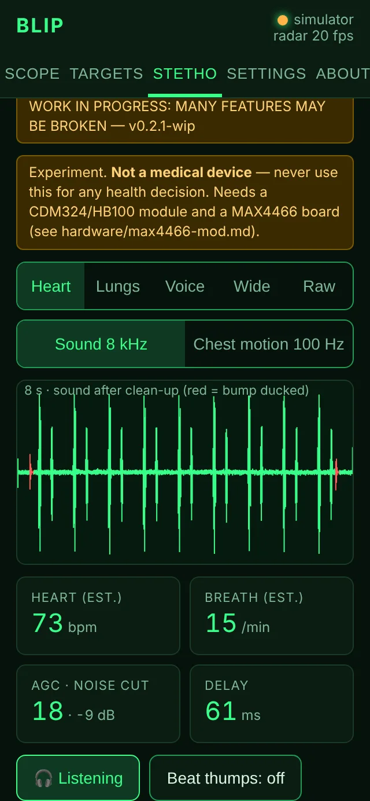
</p>
<p align="center"><i>Simulator screenshot. The real thing never got past the noise floor.</i></p>


## What exists vs what doesn't

| Part | State |
|---|---|
| RD-03D frame parser (sign bits, resync, ACK tolerance) | Done; unit-tested natively in C++ and Python (`tests/`) |
| Single/multi-target mode command | **Fixed in v0.2.1**: now wrapped in enable/end-config like the original project (earlier versions probably did nothing) |
| "Smart" target filter (own track ids, smoothing, hides flickers, wall reflections, fans) | **Experimental, opt-in.** Native tests on synthetic scenes pass; not tried in a real room |
| Auto-sleep + optional power switches for the RD-03D and the CDM324 | Written, compiles; not tried on hardware |
| Phone web UI: scope, targets table, tracker ping, settings, about | Done; tested in Chromium against the simulator |
| Flasher page the launcher opens (Quick flash of bundled firmware, or build from source; serial output; error tips) | Done; tested end to end with stand-ins for esptool and PlatformIO (`tests/test_flasher.py`); the bundled images and the esptool command were checked with the real esptool (`image_info`: valid); **not yet used on a real board** |
| Wi-Fi hotspot + captive portal + WebSocket/HTTP API | Running on the author's bench (Nov 2026): the page loads and shows live targets |
| ESP32-C3 Super Mini and Waveshare ESP32-S3-Pico builds | **Compile cleanly** (pioarduino, Arduino-ESP32 3.3.12); not yet flashed |
| OLED mirror (0.91" 128×32 / 0.96" 128×64 SSD1306) | Works on the author's bench; found automatically at boot. The previews below are rendered by the firmware's own drawing code on a PC |
| Stetho audio clean-up on the ESP32 (bump gate, heart/lungs/voice presets, noise suppression, AGC) | Done in fixed point; native test on a synthetic scene passes (knocks −38 dB vs heart sounds, hiss −11 dB) |
| Live low-latency audio to the phone, chest-motion trace, heart/breath estimates | Done; tested in Chromium against the simulator (54–83 ms delay there) |
| Earphone (delta-sigma) and I2S amp outputs on the node | Written, compiles; **not heard yet** |
| CDM324 + modded MAX4466 front end | Built and tried on a bench (Nov 2026): static fixed by supply caps, but the heartbeat sits at the noise floor even at 2 cm. **Abandoned**: it needs a custom ultra-low-noise, high-gain instrumentation amplifier (and ideally an I/Q module) |
| Making the RD-03D itself into a Doppler stethoscope | **Not possible through its UART** — see [DESIGN_NOTES.md](DESIGN_NOTES.md) |
| RD-03D tracking in a real room | Tracks up to 3 targets, and also big metal objects as you walk towards them; noisy in a small house, outdoor test still to do |
| Clutter options (minimum range, edge limit, handheld mode, strict ghost test) | **Experimental.** Native tests on synthetic scenes pass; simulator street walk works; not tried on a real walk |
| LD2450 custom firmware tab in the flasher | **Experimental, brick risk.** Tested with stand-in tools (`tests/test_cfw_flasher.py`); never run against a real radar by Blip's author |
| Enclosure | None yet |

## Bill of materials

| Qty | Part | Notes |
|---|---|---|
| 1 | ESP32-C3 Super Mini **or** Waveshare ESP32-S3-Pico | Either; both envs in `firmware/platformio.ini` |
| 1 | Ai-Thinker RD-03D — or an HLK-LD2450 (see *Radar options*) | 5 V, ≥200 mA, UART 256000 baud, 3.3 V logic |
| 1 | Old phone / tablet / laptop with a browser | The display |
| 0–1 | SSD1306 I2C OLED, 0.91" 128×32 or 0.96" 128×64 | Optional second display |
| 0–1 | CDM324 (24 GHz) or HB100 (10.5 GHz) CW Doppler module | Optional "Stetho"; HB100 if you want to run it alongside the RD-03D (see below) |
| 0–2 | MAX4466 electret-mic amp board (Adafruit 1063 / GY-MAX4466) | The Stetho amplifier, modded: [hardware/max4466-mod.md](hardware/max4466-mod.md) |
| 0–1 | 470 Ω, 100 nF, 220 µF, 3.5 mm socket | Earphone output, [hardware/audio-out.md](hardware/audio-out.md) |
| 0–1 | MAX98357A I2S amp board + 4–8 Ω speaker | Speaker output |
| — | USB-C cable / 5 V supply, wire | The C3's 5V pin can feed the radar for bench tests |

## Wiring

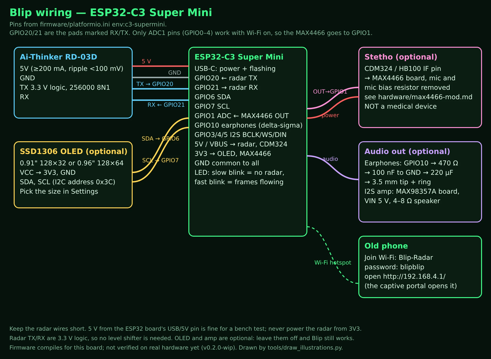

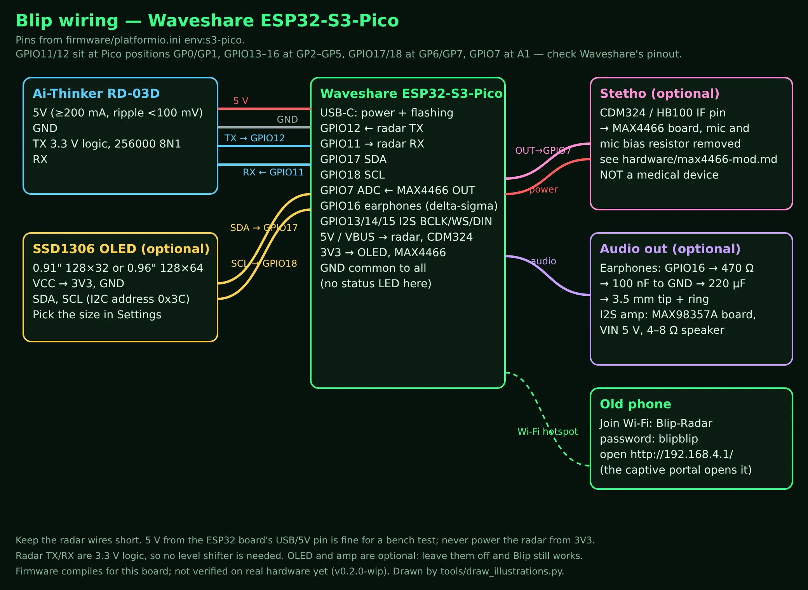

| Signal | C3 Super Mini | S3-Pico | Note |
|---|---|---|---|
| Radar TX → ESP RX | GPIO20 | GPIO12 | UART1, 256000 8N1 |
| Radar RX ← ESP TX | GPIO21 | GPIO11 | only used to send the single/multi-target command |
| OLED SDA / SCL | GPIO6 / GPIO7 | GPIO17 / GPIO18 | I2C 0x3C |
| Stetho: MAX4466 OUT | GPIO1 (ADC1) | GPIO7 (ADC1) | MAX4466 powered from 3V3 |
| Earphones (delta-sigma) | GPIO10 | GPIO16 | via 470 Ω / 100 nF / 220 µF |
| I2S amp BCLK / LRC / DIN | GPIO3 / 4 / 5 | GPIO13 / 14 / 15 | MAX98357A |
| Radar 5V / GND | 5V / GND | VBUS / GND | never 3V3 |

Pin numbers live in one place, `firmware/platformio.ini`; the diagrams are drawn from it.

### Stetho front end: CDM324 → modded MAX4466

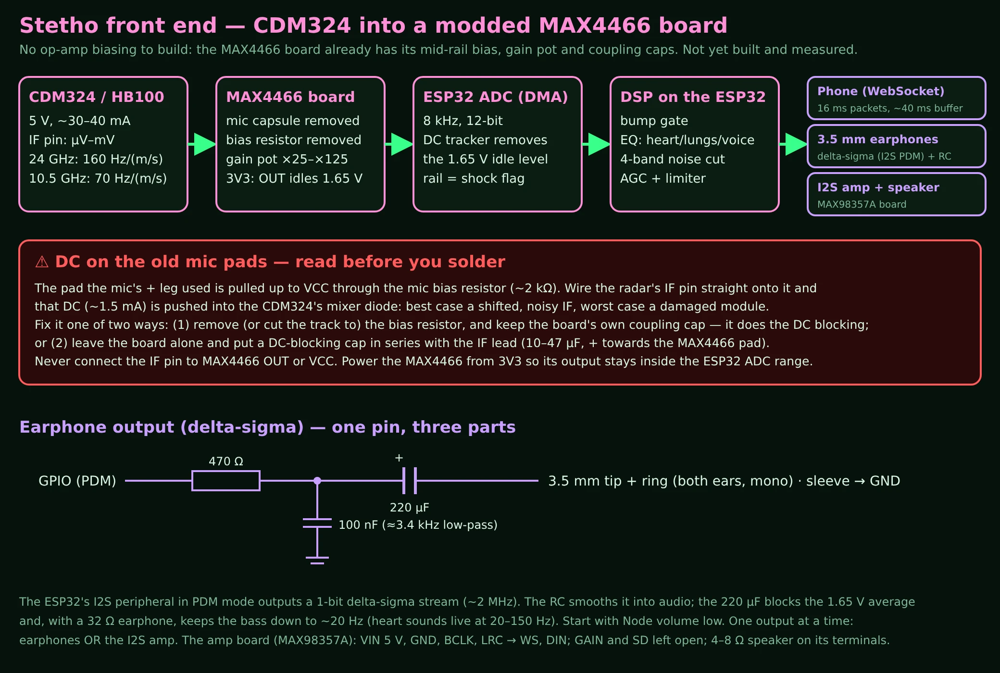

> **⚠ DC warning.** When you desolder the mic capsule and wire the radar's IF pin onto its pads, **also remove the mic bias resistor**, or put a 10–47 µF DC-blocking cap in series with the IF lead. Otherwise ~1.5 mA of DC from VCC is pushed into the CDM324's mixer diode. Power the MAX4466 from **3V3**, never 5 V. Full steps: [hardware/max4466-mod.md](hardware/max4466-mod.md).

> **RD-03D + CDM324 at the same time?** They share the 24 GHz band. The RD-03D's sweep passes right over the CDM324's frequency, so expect a buzz in the Stetho audio and possibly a noisier RD-03D. Use an **HB100** (10.5 GHz) for the Stetho, or fit a 5 V switch on the radar and choose *Radar off while listening* (`PIN_RADAR_PWR`). Details in [DESIGN_NOTES.md §11.5](DESIGN_NOTES.md#115-running-the-rd-03d-and-a-cdm324-together).

## One launcher: flash it, or try it first (double-click)

1. Unzip, then double-click **`Blip-Linux.sh`** (choose *Run*), **`Blip-Windows.bat`** or **`Blip-Mac.command`** (first time on a Mac: right-click → Open).
2. Your browser opens the **Blip Flasher** at `http://127.0.0.1:8080/` (the red page). Only Python 3 is needed to open it.
   - Want to look around before you have hardware? The small **Radar simulator ›** button (top right) opens the normal Blip page at `/sim`, with three pretend people wandering about and a synthetic Stetho signal; its **⚡ Flasher** button brings you back. Start the launcher with `--lan` to open the simulator from your phone too (the terminal prints the address).
3. **To flash a real board:** plug the board in with a USB *data* cable, pick the board (C3 Super Mini / S3-Pico), the radar (RD-03D / LD2450) and how to flash, pick the port (or leave Auto-detect), press **⚡ Flash firmware**.
   - **Quick flash (default, recommended):** writes the firmware that ships in `firmware/prebuilt/`. Nothing is hidden: the page shows the file, version, build date, size and full SHA-256, checks the file against `manifest.json` before writing, says whether it was built from exactly the source in your folder, and shows the exact esptool command. The first run installs only esptool into `.venv` (about 40 MB). No Git, no compiler.
   - **Build from source:** compiles your folder with PlatformIO so your own changes go in. The first build downloads the ESP32 toolchain (a few GB; needs the internet and **Git**; 5–15 minutes), later builds are quick.
   - The steps light up as it goes (Quick: Firmware → Flash tool → Upload → Boot; Source: Prepare → PlatformIO → Build → Upload → Boot) with a progress bar for the upload and the full log underneath (*Copy* puts it on the clipboard for a bug report).
   - If something fails, a tip explains the usual cause: serial-port permission on Linux, the board not in flashing mode (hold BOOT, tap RESET), no board or several boards found, no internet on the first run, Git missing, a port held by another program, your source newer than the bundled firmware.
   - Afterwards it shows the board's serial output (no terminal needed). *Cancel* stops any step.
   - Rather use another tool? Any ESP32 flasher can write `firmware/prebuilt/blip-<env>-full.bin` at address `0x0` (they are also attached to each GitHub release).
4. Wire the radar as above and power up. The LED on the C3 blinks slowly until frames arrive, then fast.
5. On the phone: join Wi-Fi **`Blip-Radar`**, password **`blipblip`**. The captive portal should open the scope; if not, browse to `http://192.168.4.1/`. It is the same green page as the simulator.

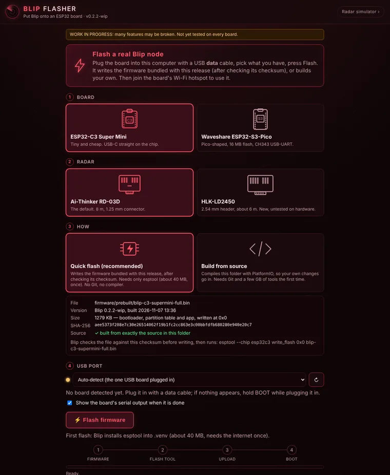

The flasher only answers this computer (`127.0.0.1` / `localhost`): starting a flash needs a per-run token only the page has, and the board, radar and port are checked against fixed lists before anything runs. `--no-flash` hides it entirely.

Prefer the terminal? `cd firmware && pio run -e c3-supermini -t upload` (envs: `c3-supermini`, `s3-pico`, `c3-supermini-ld2450`, `s3-pico-ld2450`). After editing `web/index.html` run `python3 tools/embed_web.py` (the Flash tab does this for you).

## Using it

| Screen | What it does |
|---|---|
|  | **Scope** — ±60° sector, a ring every metre to 8 m (solid and labelled at 2, 4, 6, 8 m; faint at the odd metres), one coloured blip per tracked person, labelled with distance, then whether it is moving closer or away (cm/s), then a dim #number that is only an ID. Trails fade over 4 s. *Tracker ping* is the original project's buzzer, done in the phone's speaker: faster and higher as the nearest person approaches. *Mirror L/R* flips the picture if you mount the radar the other way round. *Standing / 🚶 Handheld* switches handheld mode (below). *Show filtered* draws what Blip is hiding as dashed rings, with the reason: ghost / clutter (Smart filter), near / edge / scenery (clutter options). |
| 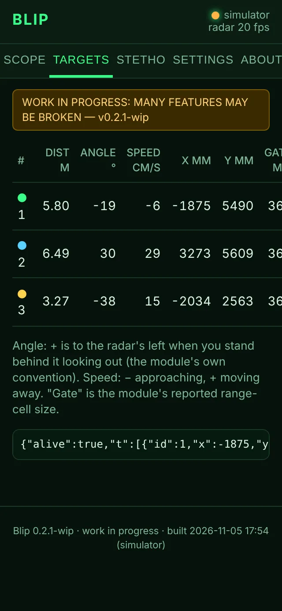 | **Targets** — the numbers behind the blips plus the raw JSON, handy when checking orientation. |
|  | **Stetho** — the optional CW Doppler channel. Presets: **Heart** (S1/S2 heart sounds, 20–150 Hz), **Lungs** (breath hiss), **Voice** (throat/larynx buzz), **Wide**, **Raw** (plain Doppler warble). *Listen on phone* plays it live; *Delay* shows how far behind real time you are. Knocks are ducked and limited (red in the trace). **Beat lock** quietens the gaps between beats once a rhythm is found; **Record 10 s → WAV** saves a recording for `tools/analyze_wav.py`; *Experiments* has ADC averaging and the burst blanker (see [docs/STETHO_SIGNAL_NOTES.md](docs/STETHO_SIGNAL_NOTES.md)). **Not a medical device.** |
| 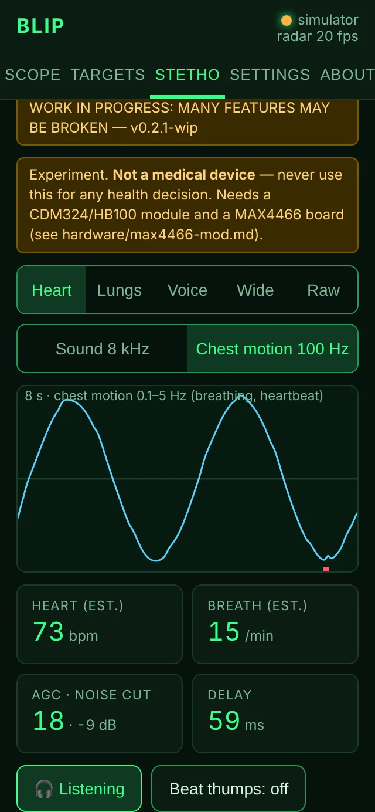 | **Chest motion** view — the 100 Hz motion trace with heart-rate and breathing rates from the pattern trackers (a `?` means only roughly steady); *Beat thumps* adds a synthetic thump on each detected beat. |
| 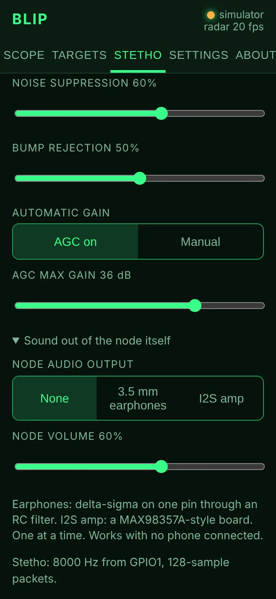 | **Clean-up on the node** — noise suppression, bump rejection, AGC or manual gain; **Sound out of the node** — earphones or I2S amp, with its own volume. |
| 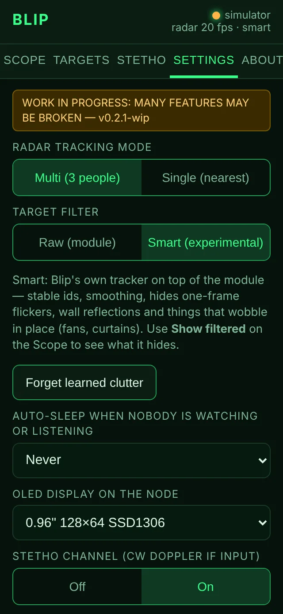 | **Settings** — single/multi target mode (also on the Radar page as *Track 1 / Track 3*), **Target filter** (Raw / Smart, experimental) with *Forget learned clutter*, the **clutter options** (below), **Auto-sleep**, OLED (Auto-detect, or a fixed size), Stetho on/off, radar-off-while-listening, hotspot name and password (reboots). |
| 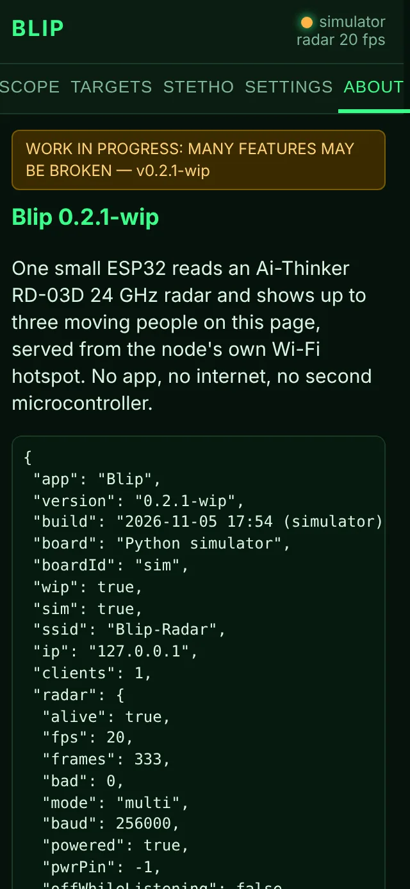 | **About** — version, build date, board, pin map and counters. |
|  | **Flash** (simulator on a PC only) — pick board, radar, Quick flash or Build from source, and port; see exactly what will be written; watch the board boot. |

OLED mirror. Each person is a circle with their distance inside: big digit = metres, small raised digit = tenths, so "1⁹" = 1.9 m. The nearest person is solid. There's no status row, so the scope fills the panel. ◆ top-left = Smart filter on; Wi-Fi icon + number top-right = phones connected; the IP shows bottom-left only until a phone joins. These are exact renders of the firmware's drawing code, not photos:

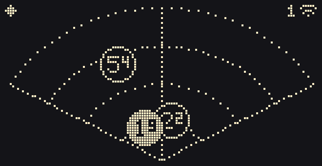 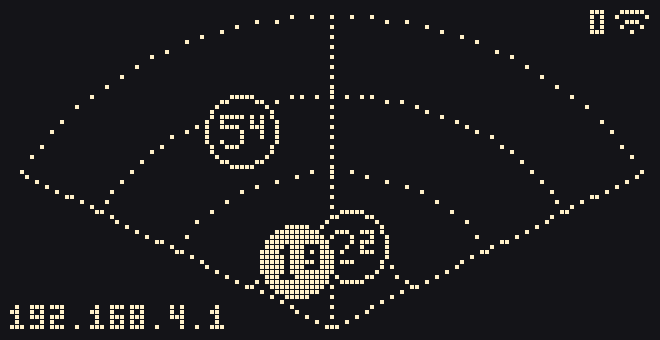

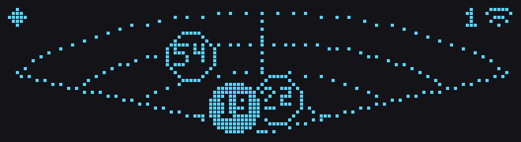

### Clutter options (Settings, added after the first street test)

All off by default except *Drop frozen targets*, all work in Raw and Smart mode, all **experimental**:

| Option | What it does | When to use it |
|---|---|---|
| **Ignore anything closer than** 0.1–1.0 m | drops contacts nearer than that | a persistent contact at 0.2–0.3 m (your own hand, wires near the antennas); 0.5 m is the module's own blind zone anyway |
| **Ignore the edges** ±65° → ±30° | drops contacts far off to the side | edge-of-view contacts are more often reflections |
| **Drop frozen targets** after 5–60 s (default 10 s, on) | drops a contact reported at exactly the same x and y to the millimetre for that long; back as soon as it moves | the module locked onto a phantom that stays after everyone has gone |
| **Handheld mode** (also on the Radar page) | while you carry it, works out your walking speed from the contacts and hides the ones closing in at exactly that speed: lamp posts, parked cars, walls. People moving on their own stay. Stops the Smart filter learning clutter. | walking about with it outdoors. Needs at least two fixed things in view to lock on; a lone lamp post is only hidden for 1.5 s after that |
| **Strict ghost test** (Smart only) | also hides a contact whose range has moved in step with a nearer one for 3 s, at any bearing, with a similar speed | reflections off side walls or cars. Can now and then hide a second person walking exactly like the first (about 1 frame in 10 in the tests) |

Tested on synthetic scenes only (`tests/test_gate.cpp`, `tests/test_tracker.cpp`), not on a real walk yet. The simulator has a **street walk** button in Settings to try handheld mode. Background in [docs/RADAR_TRACKING_NOTES.md](docs/RADAR_TRACKING_NOTES.md).

### HLK-LD2450 custom firmware (experimental, brick risk)

The flasher's third tab, **☢ LD2450 custom firmware**, runs [earlynerd/HLK-LD2450_FW](https://github.com/earlynerd/HLK-LD2450_FW) (MIT), third-party firmware that turns the LD2450 from "3 targets" into a raw range-bin stream: a Doppler spectrum in every range bin, and slow-time phase fine enough that its author shows breathing and heartbeats at about 0.8 m. **It writes to the radar itself, can brick it, and Blip's author has not tried it yet. Use a spare module.**

- Before: update the LD2450 to stock **V2.14** with Hi-Link's **HLKRadarTool** phone app (Bluetooth), and set its UART to **256000** baud in the app. Bluetooth is only for this step; the firmware itself goes over the 4-pin plug.
- Wire the 4-pin plug to a **3.3 V USB-serial adapter** (5V, GND, radar TX → adapter RX, radar RX → adapter TX), not to the ESP32.
- Then: **Probe** (writes nothing) → **Install** (type BRICK) → **Open its live viewer**. **Restore stock** puts Hi-Link V2.14 back (it then runs at 9600 baud; set 256000 in the app again).
- The data comes out of the radar's **own USB pins** (D+, D−, GND test pads on the board), not the 4-pin plug, so you need a USB cable soldered to those pads to see it. While the custom firmware is on, Blip's ESP32 can't use that radar.
- First use downloads the project at a pinned commit (about 50 MB) into `.cache/`; both images are checked against pinned SHA-256 values before anything runs.

## How it works

Short version: the ESP32 parses 30-byte frames from the radar, keeps the latest three targets, and pushes them as JSON over a WebSocket 20 times a second to whoever is on the hotspot; the browser draws the scope on a canvas. The long version, including the frame format, is in [HOW_IT_WORKS.md](HOW_IT_WORKS.md). The research — radar physics, why the RD-03D can't be a stethoscope and what can, pin choices — is in [DESIGN_NOTES.md](DESIGN_NOTES.md).

## Radar options

Blip was written for the **Ai-Thinker RD-03D** (1.25 mm 4-pin socket, 8 m, up to 3 targets). The **HLK-LD2450** (Hi-Link, 24 GHz, about 6 m, up to 3 targets with X/Y position) is supported too:

- It sends the same 30-byte frame (`AA FF 03 00`, three 8-byte slots, `55 CC`), so the same parser reads it.
- It has no RD-03D configuration commands, so Blip skips the mode command. *Single (nearest)* is picked in firmware instead.
- Use the `c3-supermini-ld2450` or `s3-pico-ld2450` build environment (or add `-DRADAR_LD2450=1`). `/api/status` reports `"model":"ld2450"` while it is running.
- A 4-pin plug (5V, GND, TX, RX; listings disagree on the pitch, so check yours). Check the labels on the module: its **TX** goes to the board's **RX** pin, and its **RX** to the board's **TX**.
- Weaker than the RD-03D on people who sit very still (the vendor notes this beyond about 2 m), and range is about 6 m.
- Still 24 GHz, so it clashes with a CDM324 in the same way. Use an HB100 for Stetho, or the radar power switch.
- **Not tested on hardware yet.** Check the angle direction on the Scope first (*Mirror L/R* in Settings if left and right are swapped).

## Troubleshooting

| Symptom | Try |
|---|---|
| Phone joins but no page opens | Browse to `http://192.168.4.1/` by hand; some phones silence captive portals. |
| "radar not sending — check 5 V and TX/RX" | Swap TX/RX (the most common mistake), confirm 5 V at the radar, baud is 256000 (not 115200). |
| Frames arrive but nobody shows up | The RD-03D only reports **moving** people. Walk about. Check *Mirror L/R* if left/right look swapped. With Smart on, try Raw: the filter may be hiding someone (*Show filtered* tells you why). |
| A contact that never goes away at 0.2–0.3 m | Usually your hand or wires/glue near the antennas. Settings → **Ignore anything closer than 0.5 m**. Bench check: put the radar on a table and walk away. |
| A ghost stays put after everyone has gone | The module has locked onto a phantom. Settings → **Drop a target frozen on exactly the same spot** (10 s by default). |
| Dots move the wrong way left/right | Fixed on 2026-11-14 (Blip had the radars' left/right backwards). If yours still does, the radar is mounted upside down: use *Mirror L/R*. |
| Lamp posts and cars show up while you walk about | Turn on **Handheld** (Radar page or Settings). |
| Phantom people / a second "you" further away | Wall or window reflections. Try Settings → Target filter → **Smart**; also mount the radar 1.2–1.5 m high and not facing glass or metal. |
| A real person keeps vanishing with Smart on | Two people walking in single file, in step, look exactly like a reflection; or someone fidgeting in one spot for 30 s gets muted as clutter. Press *Forget learned clutter* or use Raw. |
| OLED blank | The node scans for it at boot (0x3C, then 0x3D) and the Logs say what it found. If the picture is wrong or half-missing, pick the size in Settings (Auto assumes 128×64; a 0.91" panel is 128×32). Check 3V3, GND, SDA/SCL (C3: GPIO6/7, S3-Pico: GPIO17/18). SH1106 panels are not supported yet. |
| Stetho shows only noise | Expected without a module + MAX4466. With one: turn the MAX4466 pot up, keep the module still, subject within ~1 m, try the HB100 if the RD-03D is running. |
| Steady buzz in the Stetho audio | The RD-03D's 24 GHz sweep hitting the CDM324. Use an HB100 or switch the radar off while listening. |
| Howl / feedback from the speaker | The radar hears the speaker cone. Use earphones, point the speaker away, lower Node volume. |
| Phone audio lags or stutters | Check *Delay*; old phones may need the screen on. The node drops stale packets rather than lagging; "lost" counts them. |
| Flash script finds no port (C3) | Hold BOOT, tap RESET, release BOOT, run again. On macOS/older Windows the S3-Pico needs the CH343 driver. |
| Firmware doesn't compile | It builds in the author's sandbox with the pinned platform; please open an issue with the error and your PlatformIO version. |

## Known limitations

- The RD-03D is Doppler-based: stationary people vanish after a few seconds. Range resolution is coarse (0.75 m gates, 0.15 m accuracy claimed); angle is from a two-antenna phase comparison, so it wobbles.
- Through-wall detection exists but range drops hard; that's 24 GHz physics.
- Only 802.11 hotspot mode: the node does not join your home Wi-Fi (yet).
- No authentication on the hotspot beyond the WPA2 password.
- The RD-03D and a CDM324 share the 24 GHz band (see above).
- Neither radar has a sleep command; switching them off needs the optional power switches.
- Audio to the phone has ~60–120 ms delay; "no latency" over Wi-Fi isn't physically on offer. The node's own outputs are ~20 ms.
- Nothing here has met real hardware. Expect a round of fixes.

## Repository map

```
firmware/        PlatformIO project (src/main.cpp, include/rd03d.h, gate.h, tracker.h, audio_dsp.h, stetho.h, oled.h, oled_draw.h, web_ui.h)
firmware/prebuilt/  bundled whole-chip images for the four builds + manifest.json (checksums, version, source hash)
web/index.html   the phone UI (single file; embedded gzipped into the firmware)
web/flasher.html   the flasher (served by the PC tool only; never in the firmware)
web/flash_home.html  the red home page the launcher opens, with the flasher inlined
tools/           sim_radar.py, flasher.py, serial_tail.py, make_prebuilt.py, make_pdf.py, embed_web.py, draw_illustrations.py, rd03d_py.py, tracker_py.py, gate_py.py, analyze_wav.py
tests/           native C++ tests (parser, audio DSP, tracker, OLED render), Python parser + tracker cross-check, flasher (with fake_pio.py), launcher test
hardware/        wiring, MAX4466 mod (with the DC warning), earphone / I2S amp outputs
examples/        synthetic RD-03D frames for replay; dsp_before.wav / dsp_after.wav
docs/            GitHub Pages site + images + Blip-manual.pdf (built by tools/make_pdf.py)
```

## Credits

- earlynerd's [HLK-LD2450_FW](https://github.com/earlynerd/HLK-LD2450_FW) (MIT): the custom LD2450 firmware the flasher can install. Downloaded on demand, not bundled.
- Stevee87's [Arduino-ESP32-Radarproject](https://github.com/Stevee87/Arduino-ESP32-Radarproject) (MIT) for the idea, the tracker-ping behaviour, and (from reading its v1.1 firmware) the enable/end-config wrapping of the mode command. No code was copied.
- Ai-Thinker for the RD-03D protocol document; the Electronic Clinic write-up for a captured two-target frame used in the tests.
- See [THIRD_PARTY.md](THIRD_PARTY.md).
