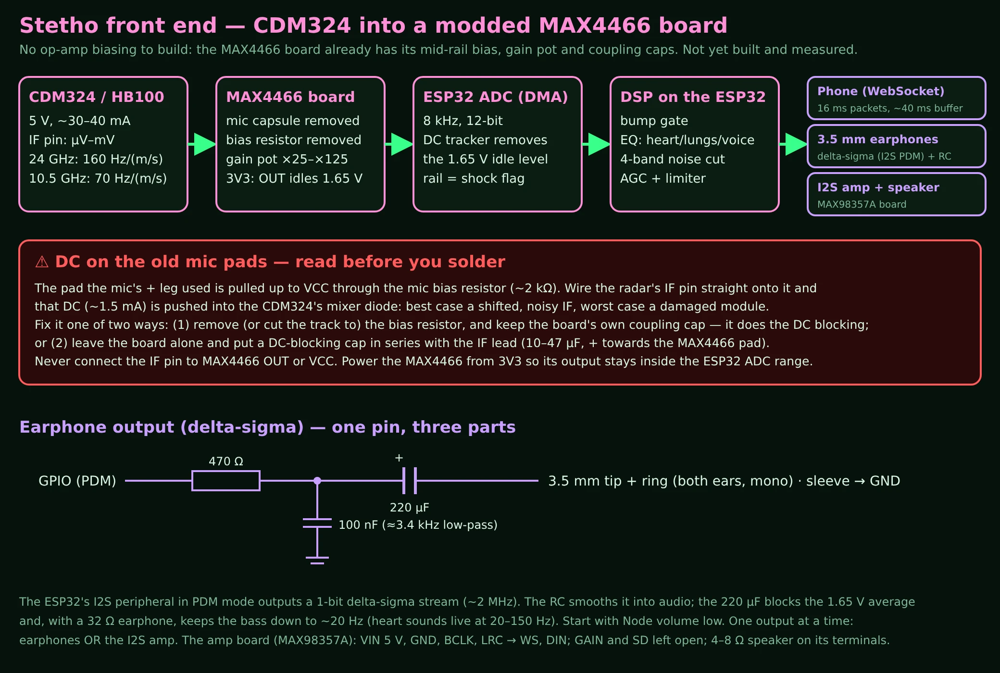

# Stetho front end: CDM324 into a modded MAX4466 board

**Not a medical device.** This is a physics experiment: listen to the tiny vibrations a CW Doppler radar picks up from a chest, a throat or a moving person.

**Status:** worked out on paper and in the firmware, **not yet built and measured**. The component values on the MAX4466 boards vary between sellers, so check yours (below).

## Why a MAX4466 microphone board
You don't want to build op-amp biasing by hand, and you don't have to. The common "MAX4466 electret microphone amplifier" board (Adafruit #1063 and many GY-MAX4466 copies) is already a complete single-supply audio preamp:

- the op-amp's input is biased at mid-rail, so the output idles at VCC/2 (1.65 V on 3V3), right in the middle of the ESP32 ADC's range;
- gain is adjustable with the little pot (about ×25 to ×125);
- the gain-setting leg is AC-coupled, so DC gain is ~1 and a DC offset on the input can't slam the output into a rail;
- it runs from 2.4–5.5 V, so you power it from the ESP32's 3V3.

**Is it OK for this?** Yes for what the Stetho tab now does (heart sounds at 20–150 Hz, throat/larynx buzz, breath hiss, the Doppler "warble" of people moving). The board is an audio amp, so it has a low-frequency corner (the cap in its gain leg) somewhere around tens of Hz. Below that corner it only passes signal at ×1. That's fine for sound. The slow chest *motion* (breathing at 0.2 Hz, the heartbeat's 1–2 Hz movement) then reaches the ADC with little gain, which is why the vitals estimates may be weak. Breathing is a big signal and should still show. See "Lowering the corner" if you want more of it.

What it won't do on its own is give the ×1000+ gain a far-away subject needs. If the signal is too small with the pot at maximum, chain a second modded board (see below).

## The mod
1. **Desolder the electret mic capsule.** Its two pads are where the radar's IF goes in.
2. **Remove the mic bias resistor** (or cut its track). This is the resistor (typically ~2 kΩ) that runs from VCC to the mic's + pad and powers the capsule. The radar must not see it — see the warning.
3. **Keep the board's input coupling capacitor.** It sits between that pad and the MAX4466 input, and it is what blocks DC between the radar and the amp.
4. Wire up:

| From | To | Note |
|---|---|---|
| CDM324 / HB100 **IF** | old mic **+** pad (the one that went to the bias resistor) | short, twisted with GND, or thin coax |
| CDM324 GND | MAX4466 GND and old mic − pad | one common ground |
| CDM324 VCC | ESP32 board 5V | ~30–40 mA |
| MAX4466 VCC | ESP32 **3V3** | so OUT can't exceed the ADC range |
| MAX4466 OUT | ESP32 ADC pin (C3: GPIO1, S3-Pico: GPIO7) | |

5. Set the gain pot to the middle. In the phone's Settings, turn **Stetho** on and watch the Stetho tab. If the waveform shows "rail" or clipping, turn the pot down.

> ### ⚠ DC on the old mic pads — read before you solder
> The mic's + pad is pulled up to VCC through the mic bias resistor. If you wire the radar's IF pin straight onto it and leave that resistor in place, about 1.5 mA of DC is pushed into the CDM324's IF pin, which is the mixer diode's output. At best you get a shifted, noisier IF. At worst you damage the module.
>
> Fix it **one** of two ways:
> 1. **Remove the bias resistor** (recommended) and keep the board's own coupling cap, which does the DC blocking; or
> 2. leave the board alone and put a **DC-blocking capacitor in series with the IF lead**: 10–47 µF, with + towards the MAX4466 pad (that side sits near VCC). The bias resistor then loads the IF a little, so expect slightly less signal.
>
> Never connect the IF pin to MAX4466 OUT or VCC. Never run the MAX4466 from 5 V when its OUT goes to the ESP32: the idle level would be 2.5 V and a loud signal would drive the pin past 3.3 V.

## If the Stetho tab shows nothing
The box at the top of the Stetho tab says where it stops:
- **"Stetho is off"**: press *Turn it on* (or Settings → Stetho channel → On).
- **"could not start"**: the reason follows; usually the pin isn't an ADC1 pin in your build.
- **"reads 1.6 V… almost flat"**: the MAX4466 is fine but nothing is coming in. Wave a hand a few cm from the radar, check the IF wire and the common ground, turn the gain pot up.
- **"stuck near 0 V"**: OUT isn't reaching the pin, or the board has no 3V3/GND.
- **"stuck near the top"**: the MAX4466 is on 5 V (move it to 3V3), or the pin is damaged. On the C3 Super Mini GPIO3 or GPIO4 can take over (rebuild with `-DPIN_STETHO_I=3`); on the S3-Pico any of GPIO1–10.

With a multimeter, MAX4466 OUT should idle at about 1.65 V with the radar still. The serial monitor (115200) prints a `stetho:` line every 5 s with the same numbers.

## Check your board's values
Sellers differ, and I could not get a readable copy of the reference schematic from here, so measure your board rather than trust a number:
- **Input coupling cap**: in series between the mic + pad and the chip's input. It is usually 1 µF or more.
- **Gain-leg cap**: in series with the small resistor that runs from the chip's − input towards ground or mid-rail. Together they set the low-frequency corner: f ≈ 1 / (2π·R·C). For example, 1 kΩ with 4.7 µF gives about 34 Hz.

## Lowering the corner (optional, for more chest motion)
Replace the gain-leg cap with a bigger electrolytic (e.g. 100–220 µF, + towards the op-amp input side): with 1 kΩ that moves the corner to ~1 Hz or below. The board then takes a few seconds to settle after power-up. Heart *sounds* are unaffected; slow chest motion gets far more gain. Keep the input coupling cap ≥ 1 µF.

## More gain: two boards in a row
Mod a second board the same way (mic **and** bias resistor removed). Wire the first board's OUT to the second board's old mic + pad, and the second board's OUT to the ESP32. Both boards run from 3V3, with a common GND. Each board's own coupling cap blocks the previous board's 1.65 V. Start with both pots low.

## HB100 instead of CDM324
Same wiring (HB100 pins: +5V, GND, IF). It runs at 10.525 GHz, so the phase swing for the same movement is about 2.3× smaller (weaker heart signal). But it **does not clash with the RD-03D** (see [DESIGN_NOTES.md](../DESIGN_NOTES.md#115-running-the-rd-03d-and-a-cdm324-together)).

## Ready-made alternatives
- **MAX9814 boards** have their own automatic gain control. Avoid them here: their AGC pumps on every knock and fights the AGC on the ESP32.
- **"HB100/CDM324 Doppler backpack" boards** (e.g. limpkin's, now retired) are tuned for speed measuring. They output a frequency/square wave and have a low upper cutoff, so they are not suited to listening.
- **KY-037/KY-038 "sound sensor" boards** are comparators, not linear amps. Not suitable.

## If you'd rather build your own amp
The previous version of this page proposed two op-amp stages (MCP6002, ×100 then ×30–100, mid-rail bias, 0.05 Hz–1 kHz). It's still valid if you want the full vitals band with lots of gain. Keep the output on 3V3, with a 1 kΩ series resistor and clamp diodes before the ADC.

## Firmware side
- The ADC runs in DMA mode at 8 kHz on `PIN_STETHO_I` (`firmware/platformio.ini`). A ~2 s DC tracker removes the 1.65 V idle level.
- Processing on the node (`firmware/include/audio_dsp.h`): bump gate, preset EQ, 4-band noise suppressor, AGC and limiter.
- Outputs: the phone ([HOW_IT_WORKS.md](../HOW_IT_WORKS.md)), 3.5 mm earphones and an I2S amp ([audio-out.md](audio-out.md)).
